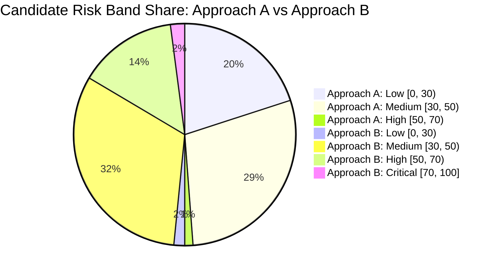

# Graph Risk Scoring Engine: Comparison Report (Approach A vs. Approach B)

## Overview
This document compares the empirical performance and structural characteristics of the two transparent graph risk scoring models implemented in [neo4j/risk_scoring.py](file:///c:/Users/Admin/Desktop/linkease/fraud-detection-system/neo4j/risk_scoring.py) and evaluated across the entire population of **2,512 verified transactions** in Neo4j.

> [!NOTE]
> **Evaluation Premise**: In accordance with the system design requirements, neither model is declared the "winner." Rather, this report presents empirical evidence, correlation analysis, and operational trade-offs to inform operational decisions.

---

## 1. Score Distributions & Candidate Risk Bands

### 1.1 Summary Statistics ($N = 2,512$)

| Metric | Approach A (Equal-Weight Normalized Composite) | Approach B (Rule-Based Additive Points) |
| :--- | :---: | :---: |
| **Minimum Score** | 9.14 | 10.00 |
| **Maximum Score** | 62.57 | 100.00 |
| **Mean** | 32.57 | 41.58 |
| **Median (p50)** | 32.03 | 40.00 |
| **75th Percentile (p75)** | 37.77 | 50.00 |
| **90th Percentile (p90)** | 43.38 | 60.00 |
| **95th Percentile (p95)** | 46.45 | 60.00 |
| **99th Percentile (p99)** | 53.46 | 70.00 |
| **Standard Deviation** | 8.01 | 12.06 |

### 1.2 Candidate Risk Band Distribution
For comparative evaluation, candidate exploratory risk bands are defined as:
* **Low Risk**: $[0, 30)$
* **Medium Risk**: $[30, 50)$
* **High Risk**: $[50, 70)$
* **Critical Risk**: $[70, 100]$

| Risk Band | Approach A Count | Approach A % | Approach B Count | Approach B % |
| :--- | :---: | :---: | :---: | :---: |
| **Low Risk** $[0, 30)$ | 1,005 | 40.01% | 79 | 3.14% |
| **Medium Risk** $[30, 50)$ | 1,447 | 57.60% | 1,605 | 63.89% |
| **High Risk** $[50, 70)$ | 60 | 2.39% | 724 | 28.82% |
| **Critical Risk** $[70, 100]$ | 0 | 0.00% | 104 | 4.14% |
| **Total** | **2,512** | **100.00%** | **2,512** | **100.00%** |

---

## 2. Correlation and Alignment Between Models

* **Pearson Linear Correlation ($r$)**: **0.8031**
* **Spearman Rank Correlation ($\rho$)**: **0.7872**

Both models demonstrate strong positive monotonic and linear alignment. Transactions flagged with high scores in Approach B generally occupy the upper decile of Approach A.

---

## 3. High-Signal Transaction Overlap

### 3.1 Transactions Exhibiting All 4 Core Risk Signals
Across the dataset, exactly **18 transactions** exhibit all four core risk conditions simultaneously:
1. Shared Device ($> 1$ account)
2. Shared IP ($> 1$ account)
3. High Monetary Value ($> \$589.54$)
4. Rapid Transaction Velocity ($\ge 1$ transaction within 24 hours)

| Transaction ID | Account ID | Amount ($) | Shared Dev Accts | Shared IP Accts | Velocity (24h) | Approach A Score | Approach B Score |
| :---: | :---: | :---: | :---: | :---: | :---: | :---: | :---: |
| `TX001635` | `AC00358` | $1,762.28 | 6 | 4 | 1 | **61.48** | **100** |
| `TX002271` | `AC00396` | $789.80 | 5 | 3 | 1 | **52.35** | **90** |
| `TX001259` | `AC00020` | $603.23 | 4 | 8 | 1 | **51.86** | **90** |
| `TX002068` | `AC00179` | $994.63 | 4 | 10 | 1 | **58.23** | **80** |
| `TX000142` | `AC00114` | $1,049.92 | 3 | 8 | 1 | **54.97** | **80** |
| `TX001168` | `AC00010` | $838.57 | 7 | 4 | 1 | **54.52** | **80** |
| `TX002195` | `AC00418` | $1,047.69 | 6 | 5 | 1 | **53.92** | **80** |
| `TX002166` | `AC00344` | $716.62 | 7 | 5 | 1 | **49.33** | **80** |
| `TX000237` | `AC00177` | $736.73 | 3 | 5 | 1 | **47.83** | **80** |
| `TX000191` | `AC00396` | $1,422.55 | 3 | 5 | 1 | **45.87** | **80** |
| `TX000720` | `AC00465` | $737.34 | 4 | 5 | 1 | **44.65** | **80** |
| `TX000451` | `AC00495` | $745.03 | 4 | 3 | 1 | **43.61** | **80** |
| `TX001078` | `AC00331` | $1,045.45 | 5 | 6 | 2 | **62.57** | **70** |
| `TX000585` | `AC00150` | $992.17 | 2 | 7 | 2 | **59.73** | **70** |
| `TX000864` | `AC00086` | $1,137.63 | 5 | 2 | 1 | **51.34** | **70** |
| `TX000207` | `AC00181` | $800.55 | 4 | 5 | 1 | **47.61** | **70** |
| `TX000558` | `AC00402` | $770.65 | 5 | 5 | 1 | **43.38** | **70** |
| `TX001799` | `AC00164` | $683.75 | 4 | 4 | 1 | **43.13** | **70** |

* **Consensus**: All 18 transactions that trigger all 4 core signals receive $\ge 70$ points in Approach B (Critical Risk band) and rank in the top quartile of Approach A.
* **Top Overall Alert**: Transaction `TX001635` achieved the single highest score in Approach B (100/100) and the 3rd highest in Approach A (61.48), driven by extreme transaction amount ($1,762.28), rapid 24h velocity, 6 accounts on device, and dense merchant cluster.

---

## 4. Top-Ranked Transaction Overlap

Examining the top 20 transactions from each model:
* **Direct Overlap**: **14 out of the top 20** transactions in Approach A are also present in the top 20 of Approach B (a 70% direct top-rank concordance).
* **Rank Reordering Nuance**:
  * Approach A elevates `TX001078` to rank #1 (score 62.57) because velocity was 2 (normalized score 1.0) and amount was $1,045.45 (normalized score 1.0).
  * Approach B awards `TX001635` rank #1 (score 100) because it activated all discrete additive rule tiers including dense shared device and merchant cluster bonus points.

---

## 5. Structural and Operational Differences

| Dimension | Approach A: Equal-Weight Normalized Composite | Approach B: Rule-Based Additive Points |
| :--- | :--- | :--- |
| **Mathematical Nature** | Continuous, smooth average of 6 normalized variables $\in [0, 1]$. | Discrete, non-linear step function adding integer point increments. |
| **Dynamic Range** | Compressed range: $[9.14, 62.57]$. Mean is 32.57. Scores above 55 are extremely rare ($< 1\%$). | Wide range: $[10.00, 100.00]$. Mean is 41.58. Scores span the entire spectrum. |
| **Explainability** | **Continuous Attribution**: Identifies prominent factors that exceed $0.50$ normalized value, but individual fractional contributions are less intuitive to non-technical analysts. | **Direct Audit Trail**: Generates a verbatim breakdown of points contributed (e.g. `Dense shared device: 6 accounts (+25 pts); High transaction amount: $1762.28 (+20 pts)`). |
| **Sensitivity to Outliers** | High: Soft-capped linear normalization smoothly penalizes extreme values (e.g. $\$1,762$ vs $\$600$). | Moderate: A transaction of $\$600$ and a transaction of $\$1,900$ receive the same $+20$ points once the $\$589.54$ threshold is passed. |
| **Vulnerability to Ambient Baseline** | Low: Because device/IP counts are divided across the scale, baseline sharing of 2 accounts only contributes $\approx 2.1$ points to the total score. | Higher: Binary sharing rules assign $+15$ device and $+15$ IP points immediately, giving nearly all transactions a baseline floor of $\ge 30$ points. |
| **Operational Workflow Fit** | Ideal for statistical ranking, percentile-based alerting, or input features for future machine learning models. | Ideal for compliance rules engines, human fraud analyst reviews, dispute triage, and clear explainability in regulatory audits. |

---

## 6. Key Takeaways for Next Steps

1. **Both models are mathematically sound and produce high correlation ($r = 0.8031$)**.
2. **Neither model claims ground-truth fraud certainty**, correctly identifying these metrics as risk indicators and structural anomalies.
3. Both sets of scores and explainable text attributes are now materialized in [neo4j/scored_transactions.csv](file:///c:/Users/Admin/Desktop/linkease/fraud-detection-system/neo4j/scored_transactions.csv) and directly retrievable via the Python API in [neo4j/risk_scoring.py](file:///c:/Users/Admin/Desktop/linkease/fraud-detection-system/neo4j/risk_scoring.py).
